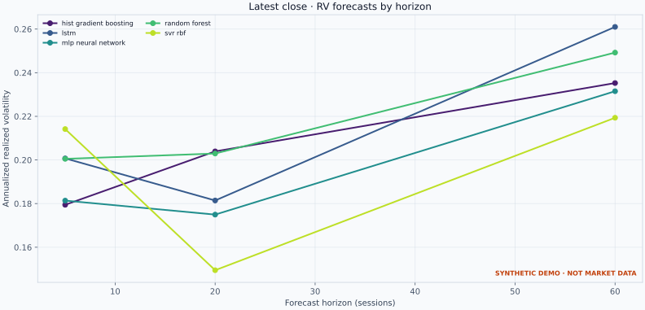
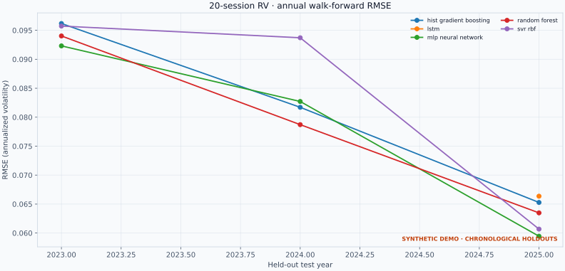
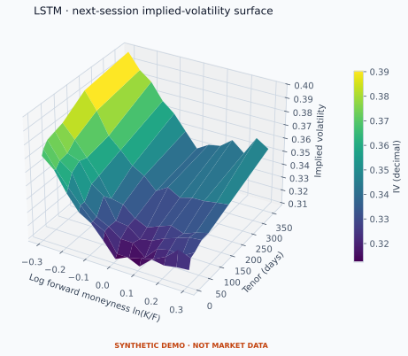

<div align="center">

# SK Hynix Volatility Lab

**An end-to-end research workbench for realized volatility, option-implied volatility, and forecast evaluation.**

[](pyproject.toml)
[](ROADMAP.md)
[](#reproducible-demo)

</div>

> **Research-only software.** The included showcase uses generated prices and synthetic option quotes. It is not market evidence, a profitability claim, or a live trading system. Genuine KRX option history requires an authorized data provider; no such feed is bundled.

## See the models at work

These reproducible examples are generated by `skhynix-vol demo-research`. They are explicitly labeled **synthetic** and are included so the project can be explored without market-data credentials.

### Realized-volatility forecasts





### Learned implied-volatility surface



The forecast grids, evaluation metrics, and run manifest are available as browsable examples: [latest RV forecasts](docs/examples/rv-ml-latest-forecasts.csv) · [RV walk-forward metrics](docs/examples/rv-ml-walk-forward-metrics.csv) · [latest LSTM IV grid](docs/examples/iv-lstm-latest-forecast.csv) · [LSTM IV walk-forward metrics](docs/examples/iv-lstm-walk-forward-metrics.csv) · [run manifest](docs/examples/demo-run-manifest.json).

## What this repo can do

| Research area | Capabilities |
| --- | --- |
| **Underlying data** | Download SK Hynix daily OHLCV and corporate actions from Yahoo Finance; retain raw Parquet, normalize prices, validate bars, and record source metadata. |
| **Realized volatility (RV)** | Build close-known return, rolling volatility, EWMA, volume, and drawdown features with forward 5/20/60-session RV labels. |
| **Statistical forecasts** | Compare rolling, EWMA, HAR-RV, GARCH, EGARCH, and GJR-GARCH using expanding chronological folds and horizon-aware label purging. |
| **ML and deep learning for RV** | Evaluate Random Forest, histogram gradient boosting, SVR, MLP, optional XGBoost/LightGBM, and optional LSTM; export latest forecasts and walk-forward metrics. |
| **Options data intake** | Import provider CSV/Parquet, normalize IV and contract fields, retain source and input-file hash, and produce chain coverage and quote-quality reports. |
| **IV surfaces** | Build coverage-aware forward-moneyness/tenor grids, plot surfaces, export PCA factors, and benchmark persistence, historical mean, and PCA forecasts. |
| **Deep learning for IV** | Train a PyTorch sequence-to-surface LSTM with training-window-only cell selection/imputation; export latest grids, images, and chronological metrics. |
| **Quote diagnostics** | Recalculate midpoint IV when carry inputs allow, inspect static arbitrage conditions, and project a grid to static European call-price constraints. |
| **Strategy research** | Simulate quote-based ATM straddles with optional daily delta hedging, option/hedge slippage, hedge commissions, liquidity filters, and trade-level tail-risk summaries. |
| **Offline demo** | Generate a self-contained synthetic price-and-options research run, charts, CSV reports, and a machine-readable run manifest without external market data. |

For stage-by-stage completion and remaining data work, see the [project roadmap](ROADMAP.md).

## Quick start

Python 3.10 or newer is required.

```bash
python -m venv .venv
source .venv/bin/activate  # Windows: .venv\Scripts\activate
python -m pip install --upgrade pip
python -m pip install -e '.[dev]'
```

Download daily underlying prices and run the statistical RV benchmark:

```bash
skhynix-vol download --start 2015-01-01
skhynix-vol evaluate
skhynix-vol forecast-rv
```

Install the optional deep-learning dependencies for LSTM models on RV and IV:

```bash
python -m pip install -e '.[ml-deep]'
```

On Intel macOS, the project pins the final compatible PyTorch wheel; other supported platforms use the current declared PyTorch dependency. If PyTorch is absent, non-LSTM models remain available.

## Reproducible demo

Run the complete offline showcase with generated data:

```bash
skhynix-vol demo-research
```

The command writes synthetic inputs to `data/demo_synthetic/` and reports with the `_synthetic_demo` suffix. It exercises the RV model suite, option import/validation, IV surface construction and forecasting, the IV LSTM (when PyTorch is installed), static-arbitrage diagnostics/projection, and the quote-based strategy workflow. Delete `data/demo_synthetic/` to remove generated data.

**Synthetic results are for interface and workflow verification only.** The demo's Black-76 prices, implied volatilities, and expiries are simulated; its forecasts and metrics must not be interpreted as real-market performance.

## RV forecasting workflow

Run the chronological statistical benchmarks and latest-close forecasts:

```bash
skhynix-vol evaluate
skhynix-vol forecast-rv
```

Run the ML/DL comparison and export latest forecasts:

```bash
skhynix-vol evaluate-ml
skhynix-vol forecast-ml
```

`evaluate-ml` uses annual expanding-window folds, fold-local preprocessing, and target-horizon purging. Random Forest, histogram gradient boosting, RBF-SVR, and an MLP are included. XGBoost and LightGBM are optional extras; PyTorch adds the LSTM automatically. Predictions and metrics are exported under `reports/`.

## Options and IV workflow

Yahoo Finance is used for underlying prices only; it does not provide this project's historical KRX options feed. Import authorized provider CSV or Parquet observations:

```bash
skhynix-vol import-options provider_quotes.csv --iv-units percent --source "Licensed Vendor"
skhynix-vol validate-options provider_quotes.csv --iv-units percent --source "Licensed Vendor"
skhynix-vol iv-surface
skhynix-vol evaluate-iv
skhynix-vol forecast-iv
skhynix-vol evaluate-iv-dl --quotes data/processed/option_quotes.parquet
skhynix-vol forecast-iv-dl --quotes data/processed/option_quotes.parquet
```

Quote files identify observation date, underlying, expiry, call/put, strike, bid, ask, underlying close, and source IV. Provide a forward price (preferred) or carry inputs for independent repricing. State IV units on import. The default surface uses supported grid cells only; it does not extrapolate beyond observed strike and maturity coverage. Without forwards, `iv-surface` requires `--spot-forward-approximation`, which records the carry assumption.

The IV LSTM uses recent surface snapshots to forecast the next grid. Compare it on the same chronological dates with persistence, historical mean, and PCA benchmarks; an ML forecast is a research benchmark, not evidence of economic value.

## Strategy research and backtesting

Run the quote-based straddle benchmark with explicit position size, slippage, liquidity participation caps, and a realized-loss halt:

```bash
skhynix-vol backtest --contracts 2 --fee-per-contract 10 \
  --option-slippage-bps 5 --max-relative-spread 0.25 \
  --max-volume-participation 0.10 --max-open-interest-participation 0.05 \
  --max-cumulative-loss-krw 500000
```

Participation limits require volume/open-interest fields and apply to both legs at entry and exit, as well as each hedge date. Add `--min-option-volume` or `--min-open-interest` for absolute cutoffs. The cumulative-loss budget halts new entries after a realized portfolio loss reaches the limit; it does not liquidate an open position.

Enable daily delta hedging using same-contract option quotes at each holding-session close and underlying close prices:

```bash
skhynix-vol backtest --hedge-mode daily_delta --fee-per-contract 10 \
  --hedge-slippage-bps 3 --hedge-fee-per-share 0.01 \
  --max-relative-spread 0.25 --hedge-risk-free-rate 0.03 \
  --hedge-dividend-yield 0.005
```

Carry inputs on quotes take precedence over explicit rate/yield fallbacks. The simulator skips trades when same-contract hedge quotes or liquidity requirements are missing. It exports option and hedge P&L, explicit costs, contract size, hedge turnover, drawdown, 95% loss VaR, expected shortfall, and whether the portfolio loss halt activated. It still omits margin, financing, intraday execution, exchange-specific charges, and full corporate-action handling; calibrate these settings before drawing economic conclusions.

## Reports and artifacts

Common outputs are written to `reports/`:

- RV walk-forward predictions, fold metrics, latest forecasts, price and volatility history charts, and run configuration.
- Option import manifest, chain-quality summaries, midpoint-IV validation, and static-arbitrage diagnostics.
- Daily IV surfaces, PCA scores/loadings, forecast grids and images, and walk-forward metrics.
- LSTM IV forecast grids/images and walk-forward predictions/metrics.
- Static-projection adjustments and quote-based straddle trade ledger/summary.

Large generated datasets and routine report files are git-ignored. The compact synthetic showcase in [`docs/examples/`](docs/examples/) is versioned for easy inspection; rerunning the demo refreshes the local `reports/` outputs.

## Data and interpretation notes

- Yahoo Finance is an initial research source for underlying prices, not an exchange-grade licensed feed. Verify consequential work against KRX or a suitable vendor.
- The KRX single-stock option workflow uses the SK Hynix contract multiplier of 10 shares and applies it in quote-based backtests. Confirm contract specifications and listing status against current exchange documentation before analyzing real data.
- Historical option import is provider-neutral. No KRX scraping, licensing bypass, or provider-specific network adapter is included.
- Midpoint repricing needs carry inputs. Missing values are surfaced in diagnostics rather than silently inferred.
- Static surface projection enforces European call-price shape constraints; it does not model American exercise, discrete dividends, or quote uncertainty.
- Daily delta-hedged straddles require a quote for both option legs on every holding date, and carry fields or explicit fallbacks. The simulator still does not model margin, financing, intraday execution, or all market frictions.
- No live order execution is implemented.

## Development

```bash
python -m pip install -e '.[dev]'
pytest
```

The package is organized by pipeline layer: `data/`, `features/`, `models/`, `evaluation/`, `visualization/`, and `strategies/`. CLI commands are defined in `src/skhynix_vol/cli.py`; current stages and exit criteria are tracked in [`ROADMAP.md`](ROADMAP.md).
